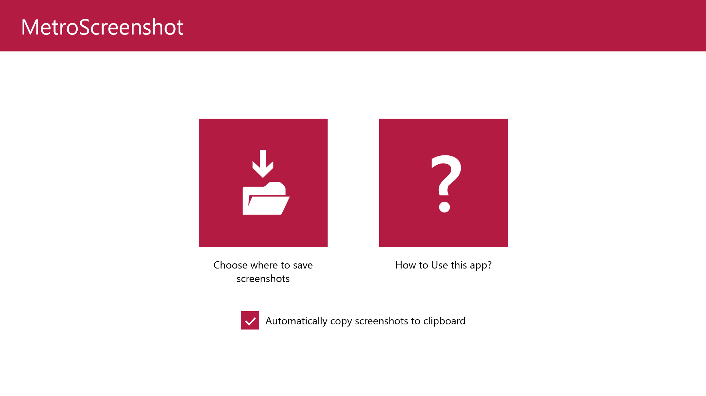

# MetroScreenshot

## Requirements:

- Windows 8.1 x86, x64 or ARM

**What is MetroScreenshot?** MetroScreenshot is a native Metro (AppX) application designed for Windows 8.1 that allows you to easily capture and save screenshots of your favorite Metro apps, games, and the Start screen.

**Latest Update:**
Version: 1.1.0.0
Update name: Quality of Life Update

**What's new?**
Wide tile support
Live Tile showing the total number of screenshots captured with MetroScreenshot
Ability to automatically copy screenshots to the clipboard
Video tutorial removed
New Charms bar options: Settings, Help, and Join our Discord server!
Option to change the default screenshot file format between PNG and JPG
Toggle to show or hide the crop button after taking a screenshot
Toggle to show or hide notifications after saving a screenshot
Toggle to turn off the screenshot counter badge on the Live Tile
Ability to crop or rotate the image before saving
Recent screenshots displayed directly on the MetroScreenshot Live Tile

-Made by: AppLove (Little Shark)
